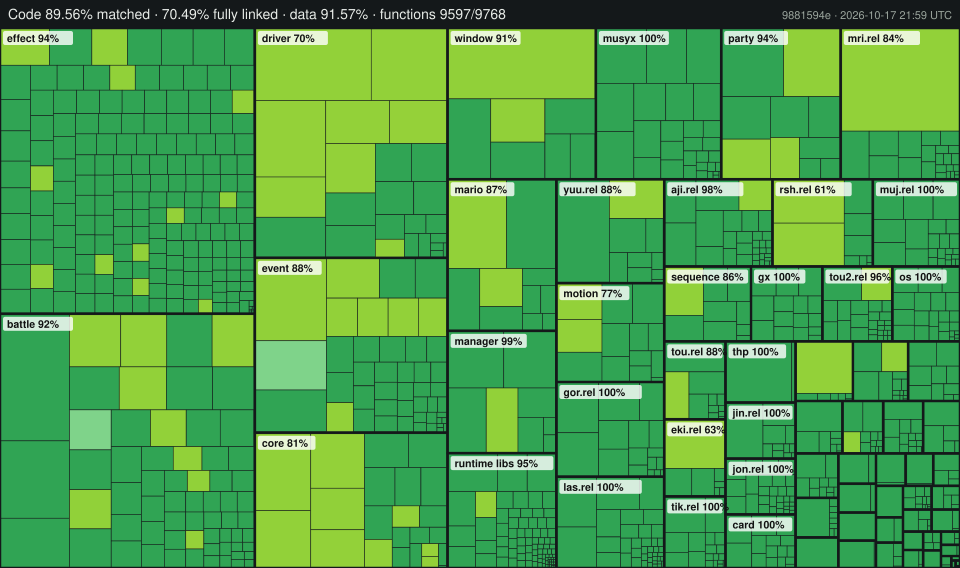

Paper Mario: The Thousand-Year Door
![Build Status] ![Progress] ![DOL Progress] ![RELs Progress] ![Linked Progress] [![Discord Badge]][discord]
=============

<!--
Replace with your repository's URL.
-->
[Build Status]: https://img.shields.io/badge/Build-passing%20(SHA--1%20OK)-brightgreen
<!---
Code progress URL:
https://progress.decomp.club/data/[project]/[version]/all/?mode=shield&measure=code
URL encoded then appended to: https://img.shields.io/endpoint?label=Code&url=
-->
[Progress]: https://img.shields.io/badge/Code-89.56%25-blue
<!---
DOL progress URL:
https://progress.decomp.club/data/[project]/[version]/dol/?mode=shield&measure=code
URL encoded then appended to: https://img.shields.io/endpoint?label=DOL&url=
-->
[DOL Progress]: https://img.shields.io/badge/DOL-89.45%25-blue
<!--
REL progress URL:
https://progress.decomp.club/data/[project]/[version]/modules/?mode=shield&measure=code
URL encoded then appended to: https://img.shields.io/endpoint?label=RELs&url=
-->
[RELs Progress]: https://img.shields.io/badge/RELs-89.92%25-blue
<!--
Replace with your Discord server's ID and invite URL.
-->
[Linked Progress]: https://img.shields.io/badge/Linked-70.49%25-green
[Discord Badge]: https://img.shields.io/discord/727908905392275526?color=%237289DA&logo=discord&logoColor=%23FFFFFF
[discord]: https://discord.gg/hKx3FJJgrV

A work-in-progress decompilation of Paper Mario: The Thousand-Year Door.



**Live progress:** an interactive treemap, updated with every commit, is at <https://claude.ai/artifact/HPQvNcsqRgunSuVpWuGnsi>.

<!-- progress-start -->
Current status (generated by `tools/update_readme.py` from the build report):

| Category | Matched code | Linked code | Linked files | Matched functions |
|---|---|---|---|---|
| All | 89.56% | 70.49% | 1163 / 1233 | 9597 / 9768 |
| DOL | 89.45% | 69.09% | 574 / 633 | 6851 / 6990 |
| Modules | 89.92% | 74.94% | 589 / 600 | 2746 / 2778 |
| Game Code | 88.32% | 66.76% | 952 / 1021 | 8105 / 8275 |
| SDK Code | 98.63% | 98.63% | 180 / 181 | 1125 / 1126 |
| MusyX Code | 100.00% | 100.00% | 31 / 31 | 367 / 367 |
<!-- progress-end -->

This repository does **not** contain any game assets or assembly whatsoever. An existing copy of the game is required.

Supported versions:

- `G8MJ01`: Rev 0 (JP)

Dependencies
============

Windows
--------

On Windows, it's **highly recommended** to use native tooling. WSL or msys2 are **not** required.  
When running under WSL, [objdiff](#diffing) is unable to get filesystem notifications for automatic rebuilds.

- Install [Python](https://www.python.org/downloads/) and add it to `%PATH%`.
  - Also available from the [Windows Store](https://apps.microsoft.com/store/detail/python-311/9NRWMJP3717K).
- Download [ninja](https://github.com/ninja-build/ninja/releases) and add it to `%PATH%`.
  - Quick install via pip: `pip install ninja`

macOS
------

- Install [ninja](https://github.com/ninja-build/ninja/wiki/Pre-built-Ninja-packages):

  ```sh
  brew install ninja
  ```

- Install [wine-crossover](https://github.com/Gcenx/homebrew-wine):

  ```sh
  brew install --cask --no-quarantine gcenx/wine/wine-crossover
  ```

After OS upgrades, if macOS complains about `Wine Crossover.app` being unverified, you can unquarantine it using:

```sh
sudo xattr -rd com.apple.quarantine '/Applications/Wine Crossover.app'
```

Linux
------

- Install [ninja](https://github.com/ninja-build/ninja/wiki/Pre-built-Ninja-packages).
- For non-x86(_64) platforms: Install wine from your package manager.
  - For x86(_64), [wibo](https://github.com/decompals/wibo), a minimal 32-bit Windows binary wrapper, will be automatically downloaded and used.

Building
========

- Clone the repository:

  ```sh
  git clone https://github.com/NWPlayer123/G8MJ01-dtk.git
  ```

- Copy your game's disc image to `orig/G8MJ01`.
  - Supported formats: ISO (GCM), RVZ, WIA, WBFS, CISO, NFS, GCZ, TGC
  - After the initial build, the disc image can be deleted to save space.

- Configure:

  ```sh
  python configure.py
  ```

  To use a version other than `G8MJ01` (USA), specify it with `--version`.

- Build:

  ```sh
  ninja
  ```

Diffing
=======

Once the initial build succeeds, an `objdiff.json` should exist in the project root.

Download the latest release from [encounter/objdiff](https://github.com/encounter/objdiff). Under project settings, set `Project directory`. The configuration should be loaded automatically.

Select an object from the left sidebar to begin diffing. Changes to the project will rebuild automatically: changes to source files, headers, `configure.py`, `splits.txt` or `symbols.txt`.


